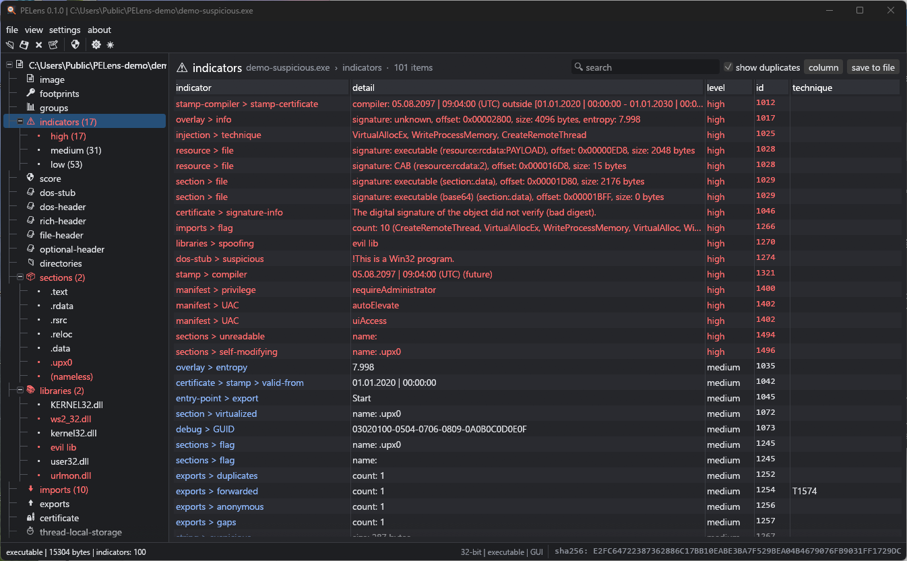
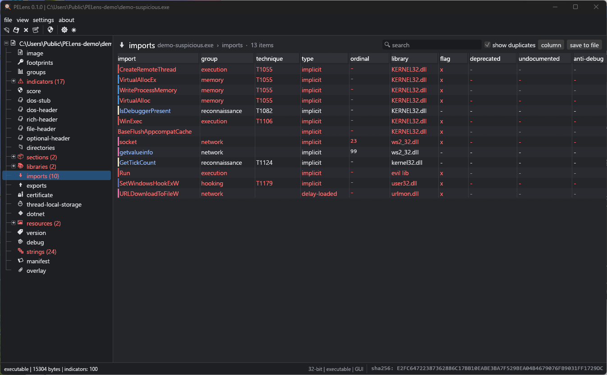
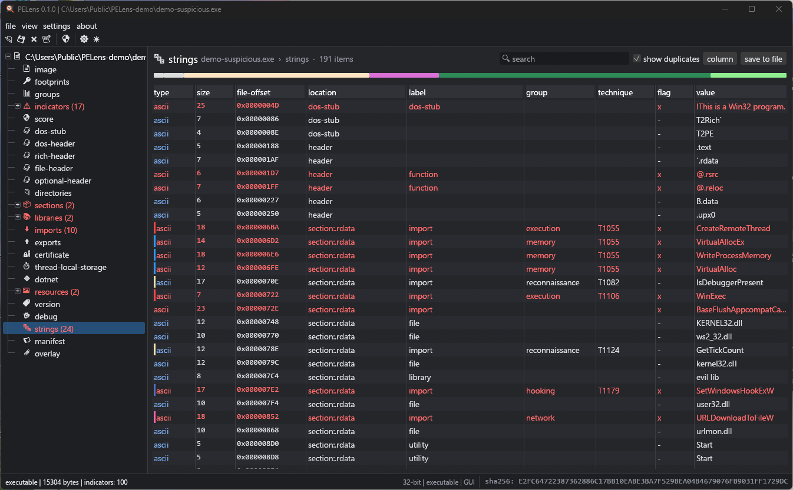
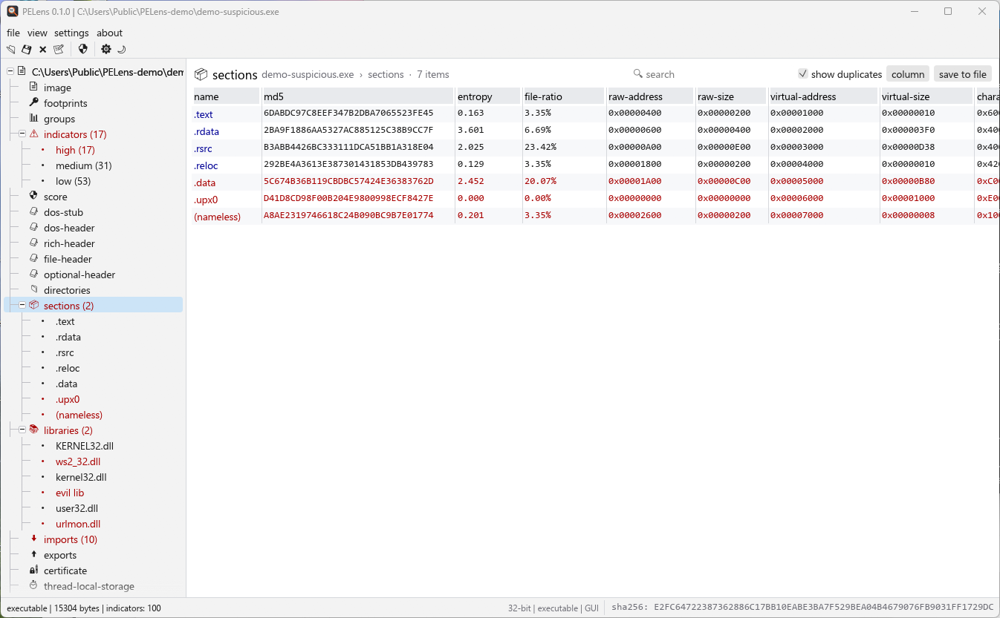
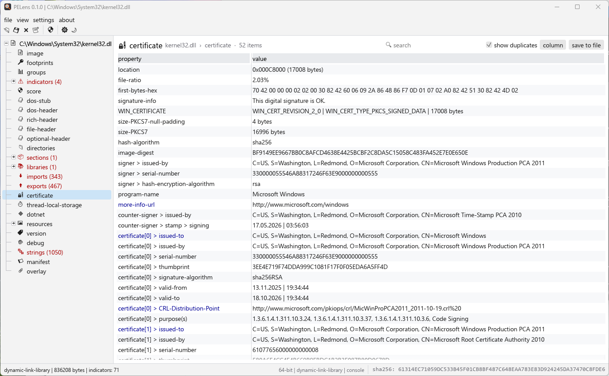
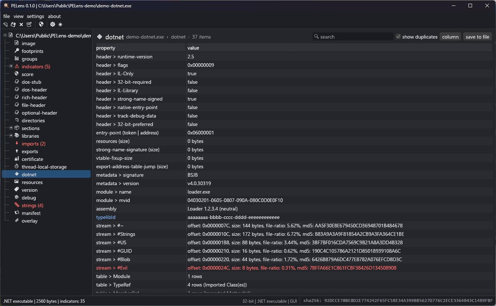
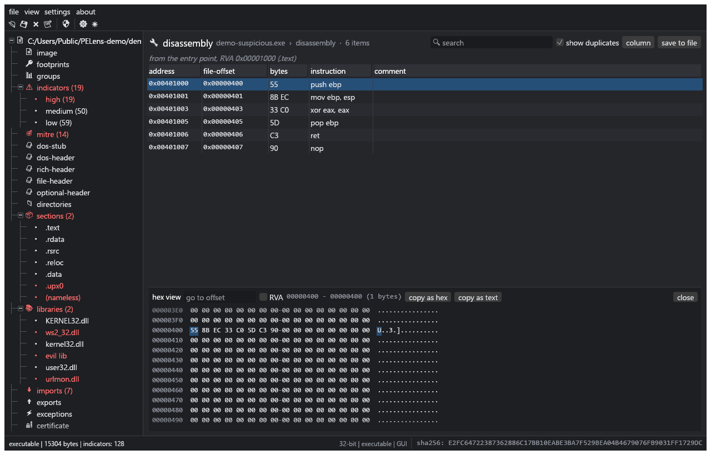
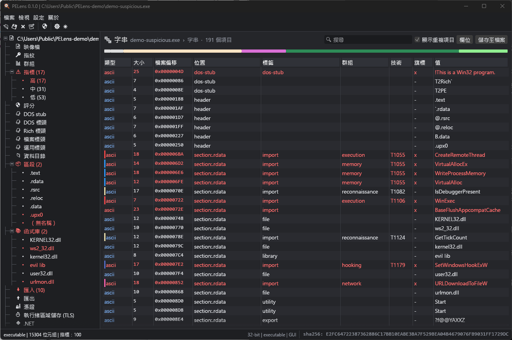
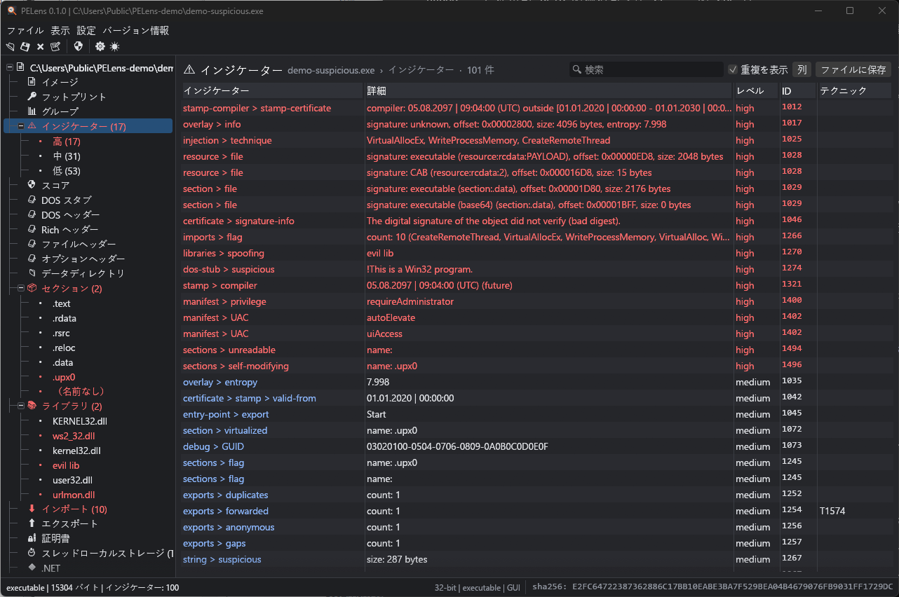

<p align="center">
  
</p>

<h1 align="center">PELens</h1>

<p align="center">
  <b>A lens for Portable Executables</b> — static malware initial assessment for Windows binaries, rebuilt in Rust.
</p>

<p align="center">
  <a href="https://github.com/taida957789/PELens/actions/workflows/ci.yml"></a>
</p>

<p align="center">
  <b>English</b> ·
  <a href="docs/readme/README.zh-TW.md">繁體中文</a> ·
  <a href="docs/readme/README.zh-CN.md">简体中文</a> ·
  <a href="docs/readme/README.ja.md">日本語</a> ·
  <a href="docs/readme/README.ko.md">한국어</a> ·
  <a href="docs/readme/README.es.md">Español</a> ·
  <a href="docs/readme/README.de.md">Deutsch</a> ·
  <a href="docs/readme/README.fr.md">Français</a>
</p>

---

PELens inspects `.exe`, `.dll` and `.sys` files **without running them**. It shows their
headers, imports, resources, certificates, .NET metadata and strings, and it raises
indicators mapped to MITRE ATT&CK. It is a from-scratch Rust remake of **pestudio 9.61**,
compatible with pestudio's XML knowledge base and its `pestudiox` command line.



## Screenshots

| | |
|---|---|
|  |  |
| Imports with groups, MITRE techniques and flags | Strings with labels, location map and groups |
|  |  |
| Sections, light mode, with the expanded tree-view | Authenticode certificate chain and WinVerifyTrust result |
|  |  |
| .NET header, metadata streams, tables and namespaces | Disassembly (calls through the IAT named) and hex view |

## Interface languages

| | |
|---|---|
|  |  |
| 繁體中文 | 日本語 |

The interface follows the Windows display language by default. Change it in view > language or
in the settings dialog, or start with `-lang:<code>` (`en`, `zh-TW`, `zh-CN`, `ja`, `ko`, `es`,
`de`, `fr`). Analysis results (table contents, indicators, reports) stay in English so they
match the reports and what the search box finds. The translations live in
`crates/pelens-gui/i18n/`.

## Features

- **27 views** like pestudio's: image, footprints, groups, indicators, MITRE, VirusTotal score,
  DOS stub and header, Rich header, file and optional headers, directories, sections,
  libraries, imports, exports, exceptions, certificate, relocations, TLS, .NET, resources,
  version, debug, strings, manifest and overlay, plus YARA and disassembly views.
- **150 indicators**, mapped to MITRE ATT&CK tactics and techniques, with severities you can edit.
- **Signature engine**: entry-point signatures (PEiD style, with nibble wildcards), text
  signatures, and embedded-file detection in resources, sections, the overlay and base64 data.
- **Parser that never panics**: imports (INT/IAT, delay-load, bound), exports (forwarded,
  anonymous, gaps), resources (version, manifest, string and message tables, dialogs, menus,
  icons), debug (RSDS, POGO, REPRO, CET), Authenticode PKCS#7 with RFC 3161 timestamps,
  and .NET metadata (all 45 tables).
- **Hunting helpers**: MD5/SHA-1/SHA-256 footprints, imphash (identical to pefile's), and links
  to VirusTotal, Google, Microsoft Learn and MITRE.
- **File modifications**: switch between DLL and EXE, set the entry point, toggle characteristics,
  delete the overlay, dump any item, and open an embedded file in a new analysis.
- **Reports** in XML, JSON or text, built from the same tables the GUI shows.
- **GUI**: tree-view, dark and light themes, sortable and filterable tables, context menus,
  drag and drop, and shortcuts (Ctrl+O, S, E, R, X; Tab moves through the tree).
- **Hex view** (Ctrl+H): draws only the visible lines, so it stays smooth on large files. Items
  with a position open there from the context menu ("show in hex"); go to an offset or an RVA,
  copy as hex or text.
- **YARA scan** (YARA-X): set a rules folder in settings > YARA or with `-yara:<dir>`. Every
  matching rule raises an indicator (severity from the rule's `severity` metadata); the matches
  open in the hex view and are part of the reports.
- **Disassembly** (x86/x64, iced-x86): from the entry point, an exported function or a TLS
  callback; calls through the IAT show the imported function, branches can be followed, and every
  instruction opens in the hex view.
- **Interface in 8 languages**: English, 繁體中文, 简体中文, 日本語, 한국어, Español, Deutsch and
  Français; by default the Windows display language.

## Install / build

**Download**: get `PELens-<version>-windows-x64.zip` from [Releases](https://github.com/taida957789/PELens/releases/latest), unzip it and run
`pelens.exe`; nothing to install. A `.sha256` file is published next to it. To build from source:

```bash
cargo build --release
# target/release/pelens.exe      (GUI)
# target/release/pelens-cli.exe  (command line)
```

You need Rust 1.88 or newer (edition 2024). It is developed and tested on Windows 11 x64.

## Usage

```bash
pelens  [file] [-xml:dir] [-view:strings] [-theme:dark|light] [-lang:zh-TW] [-expand] [-hex] [-renderer:wgpu]
pelens-cli -file:sample.exe [-report:out.xml] [-format:xml|json|text] [-vt] [-stdout] [-banner] [-xml:dir] [-yara:dir]
```

By default the CLI writes `<input>.xml` next to the sample, like pestudio does.

### Knowledge base

PELens ships its own **open knowledge base** (`kb/`, CC0): 142 indicator definitions, about 2,500
Windows API functions, about 900 suspicious strings, about 100 signatures and the MITRE ATT&CK
mapping. `tools/build_kb.py` builds it from `kb/src`; every entry was written from public sources
(see [kb/SOURCES.md](kb/SOURCES.md)) and nothing is copied from pestudio's XML files.

You can use the XML files of your own pestudio installation instead: pass `-xml:<dir>` or put an
`xml` folder next to the executable. **These files are not distributed with PELens**: they
belong to pestudio's author.

### VirusTotal

Only the **hash** is sent; samples are never uploaded. Set your own API key in the settings
dialog or in `VT_API_KEY`. API v3 is the default; v2 is available as an option.

## Project layout

| crate | role |
|---|---|
| `pe-parser` | PE parsing (bounds-checked, never panics) and patching |
| `pe-db` | pestudio XML knowledge base, read and write without reformatting |
| `pe-analysis` | indicators, signatures, strings, views, reports, actions |
| `pe-online` | VirusTotal, search links, update check |
| `pelens-cli` | command line (pestudiox-compatible) |
| `pelens-gui` | eframe/egui GUI |

Design notes: [feature inventory](docs/FEATURE_INVENTORY.md) (212 items, each with a
traceability link) · [development plan](docs/DEVELOPMENT_PLAN.md) · [task list](docs/TASKLIST.md).

## Quality

```bash
cargo test --workspace                       # 107 tests
cargo llvm-cov --workspace --summary-only    # ≈ 97 % line coverage
python tools/crossval.py 250                 # cross-check against pefile
```

## Disclaimer

PELens is an independent project. It is not affiliated with or endorsed by Winitor or
the author of pestudio. Use it only on files you are authorised to analyse.
